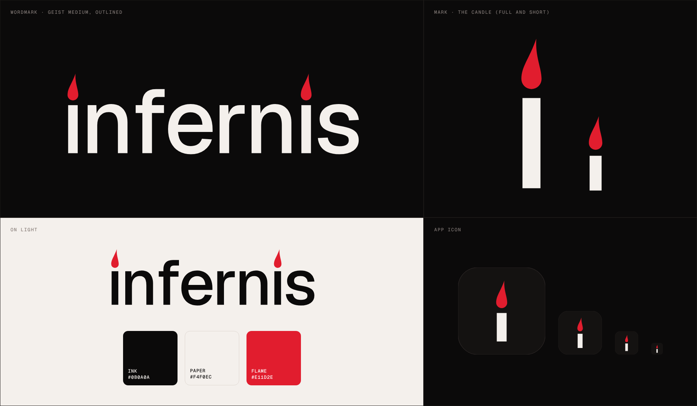

# Infernis

Brand and a launch edit for Infernis, a local AI hosting business.



## The logo

Both i's in the wordmark are candles. The stem is the letter and the dot is a
crimson flame. The mark is the same candle on its own, so the edit can open
close on one candle and pull back into the full wordmark.

| File | Use |
| --- | --- |
| `brand/infernis-wordmark.svg` | Wordmark for dark backgrounds |
| `brand/infernis-wordmark-light-bg.svg` | Wordmark for light backgrounds |
| `brand/infernis-wordmark-mono.svg` | One colour, follows `currentColor` |
| `brand/infernis-mark.svg` | The candle, full height |
| `brand/infernis-mark-small.svg` | Short candle for favicons and small sizes |
| `brand/infernis-icon.svg` | App icon (1024 × 1024) |

| Colour | Hex |
| --- | --- |
| Ink | `#0B0A0A` |
| Paper | `#F4F0EC` |
| Flame (crimson) | `#B8122F` |

Type is [Geist](https://github.com/vercel/geist-font) (SIL Open Font License, in
`fonts/`). The wordmark is outlined, so the SVGs don't need the font installed.
To change the logo, edit the constants at the top of `brand/make_brand.py` and run
it (`pip install fonttools brotli`).

## The Gate

`the-gate/infernis-the-gate.mp4` is a 58 second motion graphics edit at 1080p
and 60 fps, with sound: villain-coded corporate menace for a fictional AI
security contractor that sits in front of crypto and stock trading platforms.
The "evil" lives in the tone and the design (cold, quiet, everywhere); nothing on
screen shows anyone doing anything wrong. `the-gate/infernis-the-gate.html` plays
it in a browser.

1. **Pre-market.** A candlestick chart draws itself under a ticker tape of
   made-up symbols. "Every trade passes through something." "Usually, it's us."
2. **The map.** At the opening bell, exchanges, brokerages, custodians, market
   makers and wallets reroute through one crimson gate until 212 venues sit
   behind it. "Every exchange has a gate." "We built most of them."
3. **CerberOS Enterprise.** CerberOS pictured as a hosted product: three heads
   under load, a live ALLOW/DENY log and four numbers. "Three heads. One gate.
   No exceptions."
4. **Perimeter.** scope-fence keeps an agent inside its fence; reaches outside
   stop at the fence line. "Your agents touch what we allow."
5. **Audit.** session-receipt as an endless receipt tape. "We keep the receipts."
6. **The key.** Feather as a hardware key only a person can press.
   "Some decisions still need a hand on the key."
7. **Numbers** and **statement.** "You've never heard of us." "You've used us today."
8. **The candle.** The last red candle on a chart turns to wax, lights, and pulls
   back into the wordmark. "Nothing gets past the gate."

CerberOS Enterprise, the venues and every ticker symbol are made up for the edit.

Everything is drawn from time, frame by frame, so the page and the MP4 match
exactly. The score is synthesized from the same cue times.

### Rebuild it

Needs Python 3 with numpy, ffmpeg, and Node with Playwright.

```sh
cd projects/infernis/the-gate
python3 build.py        # inline the fonts and the wordmark -> infernis-the-gate.html
node cues.cjs           # read cue times (candles, reroutes) out of the page
python3 soundtrack.py   # synthesize build/soundtrack.wav and .mp3
python3 build.py        # build again, now with the soundtrack inside
node render.cjs         # render infernis-the-gate.mp4
```

`node render.cjs --fps 12 --scale 0.5 --out build/preview.mp4` makes a quick
preview in about a minute. `--from` and `--to` render a section. Scene timings
live in `the-gate.src.html`; each `scene(id, start, duration, ...)` call is one
shot.
